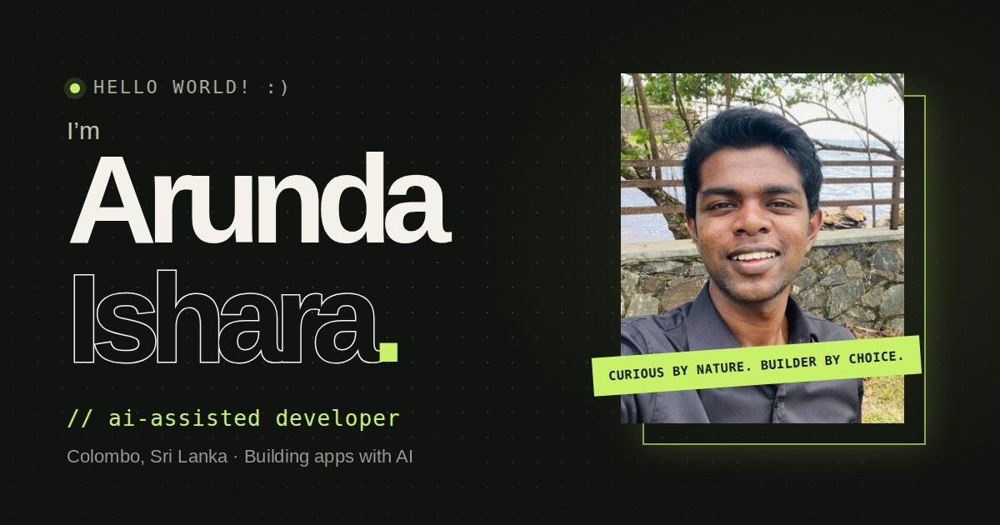

# Arunda Ishara

Self-taught developer from Colombo, Sri Lanka. I build web apps with AI tools, review and test what they produce, and keep learning as I go.

**Portfolio:** [arund-dev.github.io/portfolio](https://arund-dev.github.io/portfolio/)

## Projects

### iLike

A social platform for finding people who share your interests, designed and built end to end: product idea, interface, database, deployment and testing.

- Profiles with interests, artists and achievements
- Interest circles and people-like-you discovery
- Photo and video posts with edit and delete
- Real-time chat and notifications
- Moderation: block list, anonymous reports, admin tools, account deletion
- Customisable theme, colours and fonts

**Stack:** HTML, CSS, JavaScript, Supabase, Cloudflare, Git and GitHub

**Live:** [ilike.ilike-team789.workers.dev](https://ilike.ilike-team789.workers.dev)

### Nexus

A website for a tech solutions company with services, work, quote and contact sections. Its quote builder lets visitors pick features and a timeline and watch the price update as they go.

**Live:** [nexusportalsteam-maker.github.io/nexus-portals](https://nexusportalsteam-maker.github.io/nexus-portals/)

## This repository

My portfolio site, built with HTML, CSS and vanilla JavaScript and hosted on GitHub Pages.

## Contact

- LinkedIn: [linkedin.com/in/arund-dev](https://www.linkedin.com/in/arund-dev)
- GitHub: [github.com/arund-dev](https://github.com/arund-dev)
